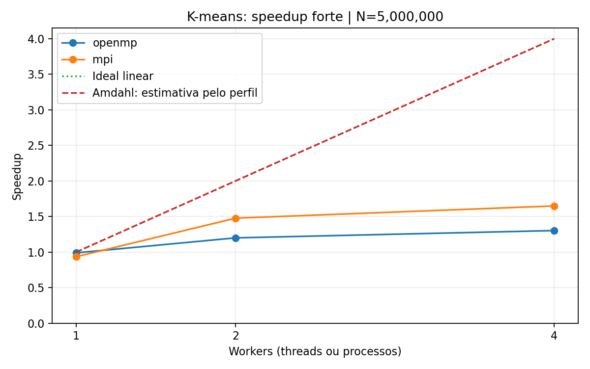
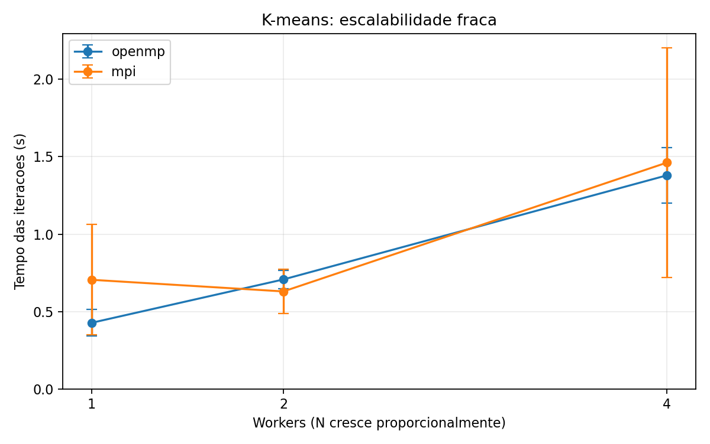

# Resultados finais — K-means no Docker

Campanha executada pelo grupo em **11/11/2026, das 18:14:18 às 18:17:32,
horário de São Paulo**, no commit **66e2e16ab971cdadb98d683c3ce316ef79889af6**, branch entrega/finalizacao.
Os resultados abaixo foram conferidos a partir dos dados brutos enviados.
A publicação da branch e a submissão do link ao professor são etapas posteriores.

## Fontes e rastreabilidade

A referência desta análise é a pasta
[resultados/campanha_docker_20261111_181418](../resultados/campanha_docker_20261111_181418/).
Ela contém [metadados](../resultados/campanha_docker_20261111_181418/metadados.json), os CSVs brutos,
190 logs de execução, cópias dos fontes efetivamente utilizados e as saídas do analisador.
Os hashes SHA-256 dos dez arquivos de fonte/configuração coincidem com as cópias arquivadas.
Os fontes sequencial, OpenMP e MPI coincidem com as versões de referência já publicadas.
O baseline fornecido pelo professor permaneceu inalterado.

Dados principais:

- [Forte: 105 medições](../resultados/campanha_docker_20261111_181418/forte.csv).
- [Fraca: 30 medições](../resultados/campanha_docker_20261111_181418/fraca.csv).
- [Perfilamento: 15 medições](../resultados/campanha_docker_20261111_181418/perfilamento.csv).
- [Resumo forte](../resultados/campanha_docker_20261111_181418/analise/resumo_forte.csv),
  [resumo fraco](../resultados/campanha_docker_20261111_181418/analise/resumo_fraca.csv),
  [perfil resumido](../resultados/campanha_docker_20261111_181418/analise/resumo_perfilamento.csv) e
  [previsões de Amdahl](../resultados/campanha_docker_20261111_181418/analise/amdahl.csv).

## Ambiente

| Elemento | Configuração registrada |
|---|---|
| Execução | Docker Desktop com mecanismo WSL2, Linux x86-64 |
| Imagem / sistema | Ubuntu 24.04; sistema reportado como Ubuntu 24.04.5 LTS |
| CPU | Intel Core i5-5300U, 2 núcleos e 4 processadores lógicos informados pelo aluno |
| CPUs disponíveis | 4; afinidade 0–3 |
| Memória visível no Linux | 8.069.680 kB, aproximadamente 7,70 GiB |
| Limites cgroup registrados | cpu.max = max 100000; memory.max = max; cpuset = 0–3 |
| C++ | G++ 13.3.0; -O2 -std=c++17; OpenMP com -fopenmp |
| MPI | Open MPI 4.1.6, processos na mesma máquina |
| Python / gráficos | Python 3.12.3; Matplotlib 3.6.3 confirmado na preparação |
| OpenMP | OMP_DYNAMIC=FALSE; OMP_PROC_BIND=FALSE; GOMP_CPU_AFFINITY removida dos subprocessos |
| MPI | --oversubscribe --bind-to none; -np em 1, 2 e 4 |

A memória de /proc/meminfo descreve a visão do ambiente Linux; não identifica
necessariamente a RAM física instalada no Windows. Quatro workers compartilham
dois núcleos físicos informados; quatro threads lógicas não são quatro
processadores físicos independentes.

O campo manual de observações ficou vazio. O protocolo recomendava alimentação
pela tomada e encerramento de trabalhos concorrentes, mas esses estados **não
foram confirmados no registro da campanha**. Essa limitação deve permanecer explícita.

## Protocolo e corretude

Na escalabilidade forte, N foi fixado em 100.000, 1.000.000 ou 5.000.000,
K=8 e IT=20. Em cada N, cinco rodadas mediram sequencial, OpenMP com 1/2/4
threads e MPI com 1/2/4 processos. Houve um aquecimento descartado por
configuração. A ordem das variantes foi embaralhada em cada rodada usando
a semente 20261111; a entrada do algoritmo continuou sendo o LCG de semente 2024.

Na escalabilidade fraca, N=1.000.000×P e K/IT permaneceram fixos, para
OpenMP e MPI. Cada modelo usa sua própria referência P=1 na mesma fase.
O perfilador adicional mediu atribuição e acumulação separadamente em cinco
repetições por N, depois de aquecimento.

O coletor concluiu 150 medições e 190 subprocessos com retorno zero e sem timeout.
Todos os checksums das medições coincidiram com as referências. Antes desta
campanha, o grupo executou **9/9 validações individuais OpenMP e 33/33 MPI**,
com erro máximo MPI de 0,0; seus relatórios estão preservados na pasta
validacoes_preexistentes. O novo perfilador foi comparado individualmente
contra os centroides do sequencial para os três tamanhos da campanha.
Essas evidências cobrem as entradas executadas, sem constituir prova universal.

Os cálculos foram conferidos novamente: 21 configurações fortes, 6 fracas,
3 resumos de perfilamento e 18 previsões de Amdahl. Os 150 registros foram
comparados com suas respectivas saídas brutas.

## Tempo considerado

O tempo principal é o laço de iterações de Lloyd, conforme o cronômetro
do baseline. Exclui geração dos pontos e preparação inicial. No MPI,
as reduções de cada iteração entram no cronômetro; MPI_Init, broadcasts
e scatters iniciais, lançamento e finalização ficam fora.

O coletor também mediu a duração externa do subprocesso. Ela inclui etapas
de preparação e lançamento e é uma métrica complementar, separada da usada
nos gráficos principais de speedup.

## Escalabilidade forte

S(P)=média sequencial / média paralela, usando **o mesmo sequencial desta
campanha e do mesmo N**. E(P)=100×S(P)/P. O desvio é amostral, com cinco
repetições; barras de erro representam desvio-padrão, não intervalo de confiança.

| N | Versão | Workers | Média (s) | Desvio (s) | Speedup | Eficiência |
|---:|---|---:|---:|---:|---:|---:|
| 100.000 | sequencial | 1 | 0,036132 | 0,004044 | 1,000× | 100,0% |
| 100.000 | openmp | 1 | 0,046986 | 0,010830 | 0,769× | 76,9% |
| 100.000 | openmp | 2 | 0,044028 | 0,007287 | 0,821× | 41,0% |
| 100.000 | openmp | 4 | 0,104329 | 0,074248 | 0,346× | 8,7% |
| 100.000 | mpi | 1 | 0,042376 | 0,005659 | 0,853× | 85,3% |
| 100.000 | mpi | 2 | 0,035476 | 0,020581 | 1,018× | 50,9% |
| 100.000 | mpi | 4 | 0,083889 | 0,089532 | 0,431× | 10,8% |
| 1.000.000 | sequencial | 1 | 0,368838 | 0,019859 | 1,000× | 100,0% |
| 1.000.000 | openmp | 1 | 0,380309 | 0,029050 | 0,970× | 97,0% |
| 1.000.000 | openmp | 2 | 0,329321 | 0,005730 | 1,120× | 56,0% |
| 1.000.000 | openmp | 4 | 0,358279 | 0,041297 | 1,029× | 25,7% |
| 1.000.000 | mpi | 1 | 0,394803 | 0,036564 | 0,934× | 93,4% |
| 1.000.000 | mpi | 2 | 0,294183 | 0,060663 | 1,254× | 62,7% |
| 1.000.000 | mpi | 4 | 0,250326 | 0,081642 | 1,473× | 36,8% |
| 5.000.000 | sequencial | 1 | 1,957904 | 0,080485 | 1,000× | 100,0% |
| 5.000.000 | openmp | 1 | 1,979156 | 0,110273 | 0,989× | 98,9% |
| 5.000.000 | openmp | 2 | 1,631648 | 0,078971 | 1,200× | 60,0% |
| 5.000.000 | openmp | 4 | 1,503139 | 0,052985 | 1,303× | 32,6% |
| 5.000.000 | mpi | 1 | 2,094306 | 0,249041 | 0,935× | 93,5% |
| 5.000.000 | mpi | 2 | 1,325666 | 0,087547 | 1,477× | 73,8% |
| 5.000.000 | mpi | 4 | 1,187470 | 0,076018 | 1,649× | 41,2% |

Para 100.000 pontos, todas as médias OpenMP ficaram acima do sequencial.
O MPI com quatro processos também foi mais lento, e os dois processos
produziram ganho médio muito pequeno. A dispersão limita a interpretação
desse caso: o coeficiente de variação MPI-4 foi aproximadamente 106,7%.

Para um milhão de pontos, OpenMP-2 teve média menor que OpenMP-4.
MPI-4 teve a menor média iterativa da campanha para esse N. A variação
MPI-4 permaneceu relevante, com desvio de 0,081642 s em média de 0,250326 s.

No maior N, OpenMP-4 obteve **1,303×** e
MPI-4 **1,649×**, com eficiências de
**32,6%** e **41,2%**.
As cinco amostras dessas duas configurações foram menores que as cinco
amostras sequenciais desse N. A menor média MPI-4 refere-se às iterações
medidas nesta máquina e sessão; não estabelece superioridade geral da tecnologia.

## Escalabilidade fraca

E_fraca(P)=100×T(1,N0)/T(P,P×N0), para cada modelo separadamente.
O ideal é manter o tempo constante ao aumentar P e N proporcionalmente.

| N total | Modelo | Workers | Média (s) | Mediana (s) | Desvio (s) | Eficiência fraca |
|---:|---|---:|---:|---:|---:|---:|
| 1.000.000 | openmp | 1 | 0,427227 | 0,409480 | 0,084937 | 100,00% |
| 2.000.000 | openmp | 2 | 0,707291 | 0,685128 | 0,059715 | 60,40% |
| 4.000.000 | openmp | 4 | 1,379823 | 1,307367 | 0,178997 | 30,96% |
| 1.000.000 | mpi | 1 | 0,705012 | 0,538077 | 0,356813 | 100,00% |
| 2.000.000 | mpi | 2 | 0,629901 | 0,608582 | 0,143847 | 111,92% |
| 4.000.000 | mpi | 4 | 1,462157 | 1,145690 | 0,741375 | 48,22% |

O OpenMP perdeu eficiência fraca ao aumentar a entrada por máquina e o número
de workers. No MPI, a eficiência média de 111,92% com P=2 exige cuidado:
a referência MPI-1 variou de 0,359094 a 1,157252 s, com coeficiente de variação
de aproximadamente 50,6%. Como análise de sensibilidade, a razão das medianas
é 0,538077/0,608582≈**88,4%**. Essa comparação secundária não substitui
a métrica principal sobre médias; mostra que a aparente superlinearidade
não é uma conclusão robusta dessas cinco amostras.

MPI-4 também apresentou variação elevada, de 0,908425 a 2,697834 s.
Não foram removidas amostras para melhorar os resultados.

## Estimativa e confronto com Amdahl

A fração potencialmente paralelizável foi estimada na cópia sequencial
instrumentada, cuja matemática foi validada por centroides:

~~~text
f = (média da atribuição + média da acumulação) / média do total perfilado
S_ideal(P) = 1 / ((1-f) + f/P)
S_ideal(infinito) = 1/(1-f)
~~~

Os dois laços sobre pontos são potencialmente paralelos. A parcela restante
inclui inicialização dos acumuladores, atualização dos centroides,
desalocação, controle e instrumentação.

| N | Atribuição média (s) | Acumulação média (s) | Total perfilado (s) | f estimado | S ideal com P=4 |
|---:|---:|---:|---:|---:|---:|
| 100.000 | 0,037911 | 0,005224 | 0,043197 | 0,99855426 | 3,982726× |
| 1.000.000 | 0,373459 | 0,052743 | 0,426296 | 0,99978049 | 3,997368× |
| 5.000.000 | 1,988230 | 0,274907 | 2,263233 | 0,99995750 | 3,999490× |

Para N=5 milhões, o confronto é:

| Modelo | P | Amdahl ideal | Speedup medido | Diferença ideal − medido |
|---|---:|---:|---:|---:|
| mpi | 2 | 1,999915× | 1,476922× | 0,522993 |
| mpi | 4 | 3,999490× | 1,648803× | 2,350687 |
| openmp | 2 | 1,999915× | 1,199955× | 0,799960 |
| openmp | 4 | 3,999490× | 1,302544× | 2,696946 |

O perfil indica que quase todo o trabalho algorítmico do laço está nas fases
que podem ser divididas entre workers. Isso não mede a fração serial efetiva
dos programas paralelos nem inclui automaticamente seus custos adicionais.
As versões paralelas introduzem criação/sincronização de regiões,
combinação de acumuladores e coletivas, e usam recursos de memória compartilhados.

O limite formal S(infinito) varia de aproximadamente **691,7× a 23.527,2×**.
Ele resulta de dividir por um resíduo muito pequeno. No maior N, esse resíduo
médio é cerca de 96 microssegundos. O valor é sensível à instrumentação e à
precisão de medir trechos curtos, e **não é uma previsão de desempenho do
notebook nem de um cluster**. Para os workers efetivamente usados, o modelo
ideal prevê aproximadamente 2× e 4×, sob hipóteses de recursos independentes
e ausência de custos extras. O equipamento com dois núcleos e SMT não
satisfaz integralmente essas hipóteses para quatro workers.

O percentual histórico de 87,38% descrevia somente a atribuição em outra
execução; o recálculo também possui trabalho paralelo. Ele não foi reutilizado
como fração paralelizável total desta campanha.

## Duração externa: uma conclusão diferente

As medições externas do coletor, sem substituir o cronômetro principal, foram:

| Versão, N=5 milhões | Tempo iterativo médio (s) | Duração externa média (s) | Speedup da duração externa |
|---|---:|---:|---:|
| sequencial, 1 worker(s) | 1,957904 | 2,054448 | 1,000× |
| openmp, 4 worker(s) | 1,503139 | 1,602381 | 1,282× |
| mpi, 4 worker(s) | 1,187470 | 1,877881 | 1,094× |

Embora MPI-4 tenha a menor média iterativa no maior N, OpenMP-4 teve a menor
duração externa entre essas duas configurações. A diferença entre as duas
métricas inclui lançamento, geração, inicialização/distribuição e finalização;
não pode ser atribuída exclusivamente à comunicação MPI. A afirmação
“MPI foi mais rápido” deve, portanto, especificar a região medida.

## Discussão técnica e limites

O código OpenMP abre duas regiões paralelas por iteração e combina
acumuladores locais em uma etapa serial O(PK). No MPI, há duas Allreduce
por iteração, totalizando 40 na entrada IT=20. São custos que o modelo
ideal simples não representa.

A divisão MPI usa blocos contíguos com diferença de no máximo um ponto;
os tamanhos principais são divisíveis por 1, 2 e 4. Não há evidência de
desbalanceamento importante por contagem de pontos nessas entradas.
Cada ponto compara todos os K centroides, o que justifica schedule(static)
na atribuição OpenMP. False sharing, banda de memória, escalonamento,
SMT e variação de frequência são hipóteses plausíveis para investigação;
esta campanha não isolou suas contribuições.

As limitações são cinco repetições por configuração, dispersão elevada em
alguns casos, observações manuais ausentes e execução em uma única máquina
com WSL2/Docker. Não foram medidos contadores de hardware ou tempos
isolados das coletivas. As barras de erro e as médias não demonstram
significância estatística. Novas coletas poderiam melhorar a estabilidade,
mas os dados atuais foram mantidos integralmente e discutidos.

## Estado de entrega

O projeto possui três implementações, validações, scripts, CSVs, gráficos,
estimativa de Amdahl e discussão crítica. A documentação deste fechamento
ainda deve ser aplicada e registrada. Depois, é necessário publicar a branch,
revisar/integrar o PR e entregar o link pelo canal indicado pelo professor.
O funcionamento no laboratório ainda não foi confirmado nesta colaboração.
O [roteiro de demonstração](ROTEIRO_DEMONSTRACAO.md) apoia a preparação.
